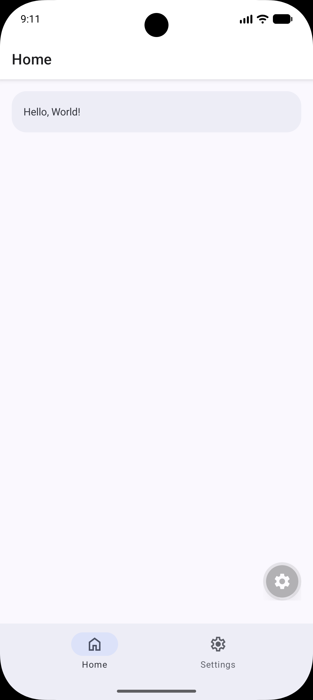

# Minimal Expo Starter

A personal Expo SDK 58 starter for native iOS and Android apps.

## Screenshots

### iOS

<p align="center">
  
  
</p>

### Android

Verified on the Android emulator.

<p align="center">
  
  
</p>

## Included

- Expo Router with native tabs
- Independent stacks for Home and Settings
- Navigation theme follows the system color scheme
- Large navigation titles on iOS
- Universal `@expo/ui` components backed by SwiftUI and Jetpack Compose
- Strict TypeScript, typed routes, React Compiler, and ESLint

## Requirements

- Node.js 22.13+, 24.3+, or 26+ (odd-numbered releases are unsupported)
- Bun
- Xcode for iOS development
- Android Studio for Android development

## Get started

Install dependencies:

```bash
bun install
```

Start the Expo development server:

```bash
bun start
```

Build and run a native app:

```bash
bun run ios
bun run android
```

## Quality checks

```bash
bun run lint
bun run typecheck
bun run check
```

The type check regenerates Expo Router types first, so newly pulled routes are included without starting the development server.

GitHub Actions runs `bun install --frozen-lockfile` and `bun run check` on every push and pull request, using Node.js 24 and Bun 1.3.14.

## Routes

```text
src/app/
├── _layout.tsx
├── (home)/
│   ├── _layout.tsx
│   └── index.tsx
└── settings/
    ├── _layout.tsx
    └── index.tsx
```

- `/` — Home
- `/settings` — Settings

## Create a new app

After copying this starter, update:

- `name` in `package.json`
- `name`, `slug`, and `scheme` in `app.json`
- `ios.bundleIdentifier` and `android.package` in `app.json`
- App icons and splash screen assets

Then remove or replace the example Home and Settings content.

## Maps demo

The `with-expo-maps` branch replaces the Home content with a native map centered
on Shanghai, using Apple Maps on iOS 17+ and Google Maps on Android. The Home
navigation header is hidden, native map controls are enabled, and foreground
location permission is requested to show the user's location.

To explore the demo on iOS:

```bash
git switch with-expo-maps
bun install --frozen-lockfile
bun run ios
```

For Android, enable **Maps SDK for Android** in Google Cloud, create an API key
restricted to your Android package name and signing certificate SHA-1, then copy
`.env.example` to `.env.local` on the demo branch and set `GOOGLE_MAPS_API_KEY`.
Build and run with `bun run android`.

Expo Maps requires a native build; Expo Go is not supported. See the demo
branch's README for configuration details.

## iPhone Duo demo

The `iphone-duo-demo` branch contains the Features tab, ArrangementView split-layout demo for iOS 27.1 and later, platform fallback, and iPhone Duo screenshots.

To explore the demo:

```bash
git switch iphone-duo-demo
bun install --frozen-lockfile
bun run ios
```
