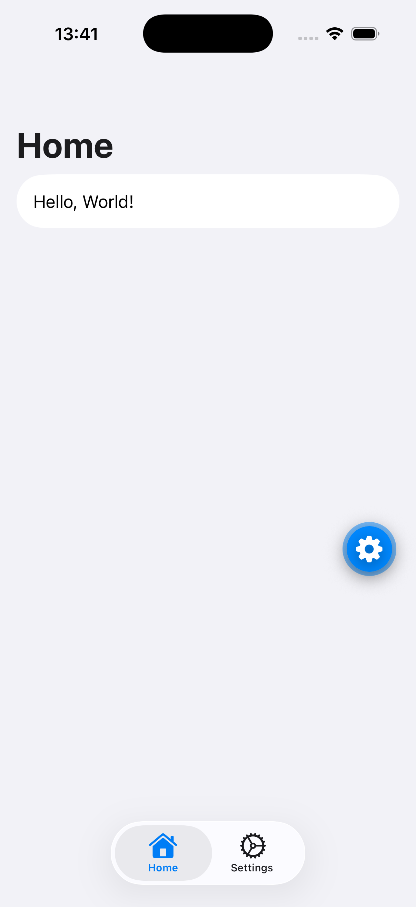
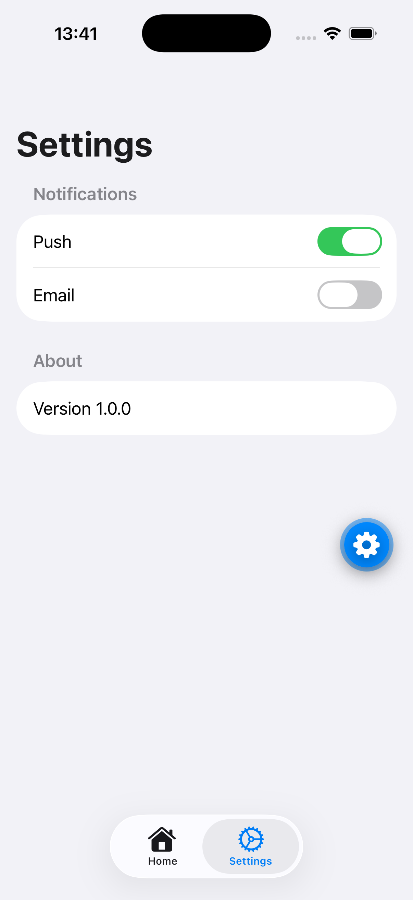
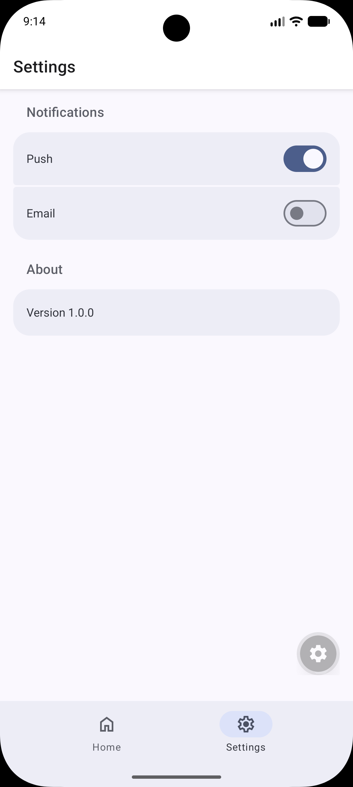

# Minimal Expo Starter

A personal Expo SDK 58 starter for native iOS and Android apps.

## Screenshots

### iOS

<p align="center">
  
  
</p>

### Android

Verified on the Android emulator.

<p align="center">
  
  
</p>

## Included

- Expo Router with native tabs
- Independent stacks for Home and Settings
- Navigation theme follows the system color scheme
- Home map using Apple Maps on iOS 17+ and Google Maps on Android
- Large navigation titles on iOS
- Universal `@expo/ui` components backed by SwiftUI and Jetpack Compose
- Strict TypeScript, typed routes, React Compiler, and ESLint

## Requirements

- Node.js 22.13+, 24.3+, or 26+ (odd-numbered releases are unsupported)
- Bun
- Xcode for iOS development
- Android Studio for Android development

## Get started

Install dependencies:

```bash
bun install
```

Start the Expo development server:

```bash
bun start
```

Build and run a native app:

```bash
bun run ios
bun run android
```

## Maps

Home displays a native map centered on Shanghai, with the navigation header
hidden. Native map controls are enabled: compass, location, scale, and pitch on
iOS; compass, location, zoom, indoor floor picker, and map toolbar on Android.
Some controls appear only when rotating, zooming, selecting a marker, or viewing
a supported indoor building. Home requests foreground location permission on
first use; the user location layer is enabled only after permission is granted.
Rebuild the native app after changing the location permission configuration.

Apple Maps requires iOS 17 or later and needs no API key. Expo Maps includes
native code, so rebuild the app after installing it; Expo Go is not supported.

For Android:

1. Enable **Maps SDK for Android** in your Google Cloud project.
2. Create an API key restricted to your Android package name (currently
   `com.qiyangdev.minimalexpostarter`) and signing certificate SHA-1.
3. Copy `.env.example` to `.env.local` and set `GOOGLE_MAPS_API_KEY`.
4. Run `bun run android` to rebuild the app.

`app.config.ts` passes the key to `android.config.googleMaps.apiKey`. Set the same
environment variable in your build environment when building remotely. Rebuild
the native app whenever the key changes. Without a configured key, Android shows
an unavailable message instead of mounting Google Maps.

See the [Expo SDK 58 Maps documentation](https://docs.expo.dev/versions/v58.0.0/sdk/maps/)
for Google Cloud setup details.

## Quality checks

```bash
bun run lint
bun run typecheck
bun run check
```

The type check regenerates Expo Router types first, so newly pulled routes are included without starting the development server.

GitHub Actions runs `bun install --frozen-lockfile` and `bun run check` on every push and pull request, using Node.js 24 and Bun 1.3.14.

## Routes

```text
src/app/
├── _layout.tsx
├── (home)/
│   ├── _layout.tsx
│   └── index.tsx
└── settings/
    ├── _layout.tsx
    └── index.tsx
```

- `/` — Home
- `/settings` — Settings

## Create a new app

After copying this starter, update:

- `name` in `package.json`
- `name`, `slug`, and `scheme` in `app.json`
- `ios.bundleIdentifier` and `android.package` in `app.json`
- App icons and splash screen assets

Then remove or replace the example Home and Settings content.

## iPhone Duo demo

The `iphone-duo-demo` branch contains the Features tab, ArrangementView split-layout demo for iOS 27.1 and later, platform fallback, and iPhone Duo screenshots.

To explore the demo:

```bash
git switch iphone-duo-demo
bun install --frozen-lockfile
bun run ios
```
